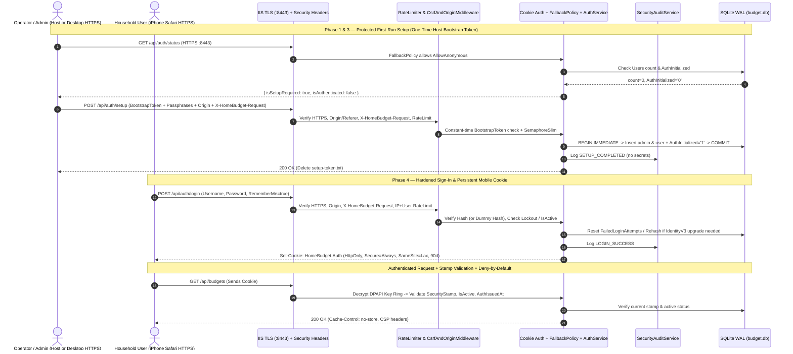

# Implementation Plan: Security-Hardened Role-Based Authentication & Mandatory LAN HTTPS (v2.9)

**Document Version:** 2.0 (Security-Hardened Revision; aligns with `design_doc.md` v2.9)  
**Target Architecture:** ASP.NET Core (.NET 10 Minimal APIs) + SQLite (WAL Mode) + Windows 11 IIS (HTTPS `:8443`) + Vanilla ES6  
**Security Roles & Fixed Household Accounts:** `Admin` (`admin`) and `User` (`user`) — neutral security roles; `DisplayName` is configurable UI metadata only and is never used for authorization.

---

## 1. Executive Summary & Architectural Goals

This plan specifies the complete, security-hardened engineering tasks to transition HomeBudget from an open household network model to an authenticated **Role-Based Access Control (RBAC)** system backed by mandatory LAN transport encryption.

### Key Deliverables & Security Guarantees:
1. **Mandatory LAN HTTPS Prerequisite (Port `8443`):**
   - Authentication cannot be enabled over plaintext HTTP. IIS binds HTTPS Port `8443` using a locally trusted `mkcert` certificate behind a `LocalSubnet` firewall rule.
   - Cookies use `CookieSecurePolicy.Always`, plain HTTP auth/API traffic is refused or redirected to HTTPS, and HTTPS responses emit `Strict-Transport-Security`.
2. **Deny-by-Default Neutral RBAC (`FallbackPolicy` + Fixed Two-Account Model):**
   - `Admin` (`admin`): Full system access including CSV uploads, raw transaction edit/split/delete, source account management, bulk rule back-propagation, income settings/overrides, backups/restore, clear history/reset all (with recent-password step-up confirmation), user administration, and security audit logs.
   - `User` (`user`): Access to Cashflow & Sankey, Monthly Budgets, Category CRUD/Merge, expense recategorization with both forward rule creation (`applyMovingForward`) and historical matching (`applyToPast`), individual rule CRUD (Sections 1 & 2 only), read-only Transaction Inspector, and self-service passphrase change.
   - Server authorization policies (`AdminOnly`, `Authenticated`, deny-by-default `FallbackPolicy`) enforce all access control independently of frontend UI visibility.
3. **Protected First-Run Bootstrap & Atomic Setup:**
   - Startup generates a host-local 32-byte one-time `setup-token.txt` (restrictive NTFS ACLs) whenever `Users` is empty and `Settings.AuthInitialized != '1'`.
   - `POST /api/auth/setup` verifies the bootstrap token in constant time, acquires a `SemaphoreSlim` lock, and inserts both `admin` and `user` plus `AuthInitialized = '1'` inside a single SQLite `BEGIN IMMEDIATE` transaction.
4. **Hardened Passphrase Policy, Rate Limiting & Atomic Lockout:**
   - **12–128 UTF-8 character** passphrases with exact whitespace preservation, paste/password-manager autofill support, common-password screening, ASP.NET Core `PasswordHasher<User>` (`IdentityV3`), and automatic rehash-on-login (`SuccessRehashNeeded`).
   - Partitioned rate limiting (`AddRateLimiter` by client IP and target username returning `429`), atomic SQLite lockout counter updates (5 failures $\rightarrow$ 15-minute lockout), dummy-hash timing equalization + generic `401` invalid-credential responses, and Admin unlock/enable-disable controls.
5. **Cookie Persistence (`RememberMe`), Session Revocation & DPAPI Key Ring:**
   - `RememberMe = true`: 90-day persistent cookie with sliding expiration capped at an **180-day absolute lifetime** (`AuthIssuedAt`).
   - `RememberMe = false`: non-persistent browser session cookie (12h idle / 24h absolute max).
   - Data Protection keys stored outside `wwwroot` in `<DatabaseDirectory>\keys\`, encrypted at rest via Windows DPAPI, restricted by NTFS ACLs, and decoupled from `.db` financial backups.
   - `SecurityStamp` validation revokes all sessions on password change (re-issuing current session), Admin reset, account deactivation (`IsActive = 0`), or emergency recovery.
6. **Layered CSRF, Same-Origin CORS, Origin Validation & Security Headers:**
   - Strict same-origin CORS, `SameSite = SameSiteMode.Lax`, `Origin`/`Referer` verification, and `X-HomeBudget-Request: 1` enforced via `CsrfAndOriginMiddleware` across all mutating endpoints (including `/api/auth/login`, `/api/auth/setup`, `/api/auth/logout`, and multipart uploads/restores).
   - CSP, `X-Content-Type-Options: nosniff`, `X-Frame-Options: DENY`, `Referrer-Policy: no-referrer`, `Permissions-Policy`, and `Cache-Control: no-store` on `/api/*`.
7. **Authoritative Identity Preservation, One-Time Recovery & Audit Trail:**
   - Restore and `Reset All` execute under `BackupService.ExecuteExclusiveLifecycleActionAsync` and preserve **ALL** `Users` rows (active and inactive), `Settings.AuthInitialized`, and `SecurityAuditLogs` atomically.
   - Host-local single-use `<DatabaseDirectory>\admin-recovery.token` replaces plaintext `appsettings.json` overrides and deletes itself immediately upon consumption.
   - `SecurityAuditService` records security events in `SecurityAuditLogs` with strict secret redaction.

---

## 2. Security Request Pipeline & Authentication Flow



---

## 3. Revised Phased Implementation Roadmap

### Phase 0: Finalize Security Contract & Endpoint Matrix
*Objective: Lock down all security policy decisions and route classifications before writing application code.*

1. **Trust Model Resolution:** Confirm `design_doc.md` Section 7.1 reflects LAN firewall as network defense-in-depth only, mandatory HTTPS, and deny-by-default server authorization.
2. **Approve Complete 51-Route Matrix:** Confirm `AllowAnonymous` allowlist (strictly `GET /api/auth/status`, `POST /api/auth/setup`, `POST /api/auth/login`), `Authenticated` shared routes, and `AdminOnly` routes (specifically resolving `GET /api/settings` $\rightarrow$ `AdminOnly` and `POST /api/rules/back-propagate` $\rightarrow$ `AdminOnly`).
3. **Approve Policy Specifications:**
   - Host bootstrap token file (`setup-token.txt`) + atomic setup transaction + `AuthInitialized` lock.
   - `12`–`128` UTF-8 char passphrase policy + `PasswordHasher<User>` `IdentityV3` + auto-rehash.
   - `RememberMe = true` (90d persistent, 180d absolute max) vs `RememberMe = false` (session cookie, 12h/24h max).
   - Step-up password confirmation on `POST /api/admin/reset-all`, `POST /api/backups/restore/{fileName}`, and `POST /api/backups/restore-upload`.
   - One-time host-local `admin-recovery.token` replacing `appsettings.json` override.
4. **Confirm Security Acceptance Checklist:** Lock the 12-item release gate criteria in Section 5.

> **Exit Criteria:** Zero unresolved security policy ambiguities remain across `design_doc.md` and this plan.

---

### Phase 1: Mandatory HTTPS, TLS & Data Protection Key Foundation
*Objective: Establish encrypted transport and ACL-protected cryptographic key storage before enabling authentication in any deployed environment.*

#### 1.1 IIS HTTPS Binding, `mkcert` Issuance & Renewal Runbook (`docs/https_setup_runbook.md`)
1. Document PowerShell installation of `mkcert` on Windows 11 (`choco install mkcert` or verified release binary) and `mkcert -install`.
2. Document SAN certificate issuance covering `homebudget.local`, host LAN IP, `localhost`, and `127.0.0.1` exported to `homebudget.pfx`, imported into `LocalMachine\My`, and bound to IIS Port `8443`.
3. Configure Windows Defender Firewall inbound rule strictly on `Private` profile for `LocalSubnet` TCP Port `8443`, and disable/redirect plain HTTP Port `8080`.
4. Document one-time household mobile client trust setup (`rootCA.pem` installation + full trust toggle in iOS `Certificate Trust Settings`).
5. Document certificate expiration (~825 days) and LAN IP change renewal script (zero database or DP-key impact).

#### 1.2 Server HTTPS Enforcement & Cookie Secure Policy (`src/HomeBudget.Web/Program.cs`)
1. Enforce HTTPS for auth & API endpoints: configure `UseHttpsRedirection()` (or custom HTTPS gate middleware controlled cleanly for automated integration test hosts) rejecting unencrypted `/api/auth/*` and authenticated `/api/*` requests (`400 Bad Request` / `403 Forbidden`) when `RequireHttps` is active (default `true` in Production).
2. Configure HSTS (`builder.Services.AddHsts(...)`, `app.UseHsts()`) emitting `Strict-Transport-Security: max-age=31536000; includeSubDomains` on HTTPS responses.
3. Set `options.Cookie.SecurePolicy = CookieSecurePolicy.Always` in `AddCookie` (with an explicit test-environment option only if an in-memory test host runs over HTTPS/TestServer, preferring `WebApplicationFactory` configured with HTTPS scheme).

#### 1.3 Data Protection Key Ring Directory, NTFS ACLs & Windows DPAPI (`Program.cs` & Deployment Script)
1. Configure persistent key directory outside IIS `wwwroot` at `<DatabaseDirectory>\keys\` (`C:\ProgramData\HomeBudget\keys\`):
   ```csharp
   var dpBuilder = builder.Services.AddDataProtection()
       .PersistKeysToFileSystem(new DirectoryInfo(keysDir))
       .SetApplicationName("HomeBudget")
       .SetDefaultKeyLifetime(TimeSpan.FromDays(90));

   if (OperatingSystem.IsWindows())
   {
       dpBuilder.ProtectKeysWithDpapi(protectToLocalMachine: true);
   }
   ```
2. Add PowerShell ACL hardening step in `docs/https_setup_runbook.md` / `docs/deployment_and_rollback_runbook.md` to disable NTFS inheritance on `C:\ProgramData\HomeBudget\` (`keys/`, `setup-token.txt`, `admin-recovery.token`, `budget.db`) and grant access exclusively to `IIS AppPool\HomeBudget` and `BUILTIN\Administrators`.
3. Document key-ring asset separation from `.db` financial backups, key backup guidance, and graceful fail-closed behavior if keys are deleted/corrupted (logs diagnostic warning and returns `401` so users cleanly re-sign in without crashing).

> **Exit Criteria:** Login payloads and `HomeBudget.Auth` cookies cannot traverse HTTP; DP keys are encrypted at rest outside `wwwroot` with restrictive NTFS ACLs.

---

### Phase 2: Identity & Audit Schema + Lifecycle-Safe Migrations, Reset & Restore
*Objective: Persist fixed household identity records and security audit logs safely across v1–v2.8 upgrades, clean resets, and backup restores.*

#### 2.1 Canonical Schema Additions (`deploy/schema.sql`)
1. Add `Users` table with neutral role semantics and lockout/revocation fields:
   - `UserId`, `Username` (`UNIQUE COLLATE NOCASE`, fixed `'admin'` / `'user'`), `PasswordHash`, `DisplayName` (cosmetic UI label), `Role` (`CHECK (Role IN ('Admin', 'User'))`), `SecurityStamp`, `FailedLoginAttempts`, `LockoutEndUtc`, `IsActive`, `LastLoginAt`, `CreatedAt`, `UpdatedAt`.
2. Add `SecurityAuditLogs` table:
   - `AuditLogId`, `TimestampUtc`, `EventType`, `Outcome`, `ActorUserId`, `ActorUsername`, `TargetUsername`, `SourceIp`, `Details`.
3. Add indexes: `IX_Users_Username`, `IX_SecurityAuditLogs_Timestamp`.
4. Seed default `Settings` sentinel `('AuthInitialized', '0')` via `INSERT OR IGNORE`.

#### 2.2 Idempotent Transactional Schema Upgrades (`src/HomeBudget.Web/Data/DatabaseInitializer.cs`)
1. In `ApplyIdempotentSchemaMigrationsAsync`:
   - Execute upgrades inside an explicit SQLite transaction (`BEGIN IMMEDIATE` / `COMMIT`, automatic `ROLLBACK` on exception so partial migrations never leave corrupt state).
   - Create `Users` and `SecurityAuditLogs` if absent and add missing identity columns idempotently via `pragma_table_info('Users')`.
   - Ensure `Settings` contains `AuthInitialized = '1'` whenever an existing database already contains rows in `Users`.

#### 2.3 Authoritative Identity Preservation Across `Reset All` & Backup `Restore` (`DatabaseInitializer.cs` & `BackupService.cs`)
1. **Clean Reset (`DatabaseInitializer.RecreateCleanSchemaAsync`):**
   - Preserve **ALL** `Users` rows (both `IsActive = 1` and `IsActive = 0`, including hashes, `SecurityStamp`, lockout state, roles, `LastLoginAt`), `Settings.AuthInitialized`, and `SecurityAuditLogs` inside the reset transaction alongside backup policy settings (`BackupAutoMode`, `BackupDebounceSeconds`, `BackupMinIntervalMinutes`, `MaxRetainedBackups`).
2. **Database Restore (`BackupService.RestoreSnapshotAsync` & `RestoreUploadedSnapshotAsync`):**
   - Acquire `BackupService.ExecuteExclusiveLifecycleActionAsync` mutex (blocking concurrent mutations/restores and canceling pending debounce backups).
   - Before replacing live `budget.db`, capture authoritative live state in memory: **ALL** `Users` rows (active and inactive), `Settings.AuthInitialized`, and `SecurityAuditLogs`.
   - Validate target snapshot via `PRAGMA integrity_check;`, create verified `pre_restore` safety backup if requested (aborting on failure), copy target snapshot to a **staged temporary DB file**, execute `ApplyIdempotentSchemaMigrationsAsync(stagedConn)`, and atomically overwrite `Users`, `AuthInitialized`, and `SecurityAuditLogs` with the authoritative live state inside a single `BEGIN IMMEDIATE` transaction before atomically swapping the validated staged DB into `budget.db` (or rolling back safely from `pre_restore` on any error).

> **Exit Criteria:** Financial restores from any older v1–v2.8 or stale backup never overwrite or roll back current passwords, stamps, lockouts, or disabled statuses; resets never wipe identity or re-open anonymous setup.

---

### Phase 3: Authentication, Password Policy, Protected Setup, Lockout, Recovery & Audit Services
*Objective: Implement security services cleanly separated from `Program.cs` so every component is independently unit-testable.*

#### 3.1 Models & DTOs (`src/HomeBudget.Web/Models/Entities.cs` & `Dtos.cs`)
- Add `User`, `SecurityAuditLog`, `AuthStatusDto`, `SetupRequest` (`BootstrapToken`, `AdminDisplayName`, `AdminPassword`, `UserDisplayName`, `UserPassword`), `LoginRequest` (`Username`, `Password`, `RememberMe`), `ChangePasswordRequest` (`CurrentPassword`, `NewPassword`), `ResetUserPasswordRequest` (`NewPassword`), `UpdateUserActiveRequest` (`IsActive`), `StepUpConfirmRequest` (`ConfirmPassword`), `UserSummaryDto` (including `RemainingLockoutMinutes`), and `AuditLogQueryDto`.

#### 3.2 Passphrase Policy Validator (`src/HomeBudget.Web/Services/PasswordPolicyValidator.cs`)
1. Enforce minimum **12 characters** and maximum **128 UTF-8 characters** (no arbitrary character-class rules).
2. Preserve exact Unicode characters and leading/trailing whitespace (no silent truncation, no `.Trim()`).
3. Reject passwords matching account `Username` or `DisplayName`, single repeated-character patterns, and an embedded offline list of trivial/breached 12+ character passphrases (e.g., `"password1234"`, `"123456789012"`, `"qwertyuiop12"`).

#### 3.3 Security Audit Service (`src/HomeBudget.Web/Services/SecurityAuditService.cs`)
1. Implement `LogEventAsync(string eventType, string outcome, int? actorUserId, string? actorUsername, string? targetUsername, string? sourceIp, string? details)` writing to `SecurityAuditLogs` and structured `ILogger`.
2. Enforce strict field redaction (truncate/sanitize `Details`; assert/block secrets) so passwords, hashes, cookies, DP keys, bootstrap tokens, and recovery secrets are never logged.
3. Implement `QueryLogsAsync(int limit, int offset, string? eventType)` for `GET /api/audit-logs`, plus automatic retention pruning (> 365 days or > 10,000 entries).

#### 3.4 Protected Authentication & Recovery Service (`src/HomeBudget.Web/Services/AuthService.cs`)
1. **First-Run Bootstrap Secret (`EnsureBootstrapTokenAsync`):**
   - When `Users` count == 0 and `Settings.AuthInitialized != '1'`, generate 32 cryptographically random bytes (`Base64Url`) and write to `<DatabaseDirectory>\setup-token.txt` (if not already present) with restrictive ACLs on Windows; log file location notice without logging the token itself to untrusted sinks.
2. **Atomic Setup (`CompleteInitialSetupAsync`):**
   - Rate-limited; verifies `BootstrapToken` via `CryptographicOperations.FixedTimeEquals`; acquires in-process `SemaphoreSlim`; opens SQLite `BEGIN IMMEDIATE` transaction verifying `Users` count == 0 and `AuthInitialized != '1'`; validates both passphrases via `PasswordPolicyValidator`; hashes via `PasswordHasher<User>` (`IdentityV3`); inserts fixed `admin` (`Role = 'Admin'`) and `user` (`Role = 'User'`) accounts; sets `Settings('AuthInitialized', '1')`; logs `SETUP_COMPLETED`; commits; deletes `setup-token.txt`.
3. **Authentication, Dummy-Timing Balance, Auto-Rehash & Atomic Lockout (`AuthenticateAsync`):**
   - Look up user by `Username` (`COLLATE NOCASE`).
   - If user not found: run dummy `PasswordHasher.VerifyHashedPassword` against a static dummy hash to prevent username-enumeration timing oracle, audit `LOGIN_FAILURE`, and return generic `"Invalid username or password."`.
   - If `!user.IsActive`: verify/normalize timing, audit `LOGIN_FAILURE` (`Details = "Inactive account"`), and return generic `"Invalid username or password."`.
   - If `LockoutEndUtc > now`: audit `LOGIN_FAILURE` (`Details = "Locked out"`), return generic throttled/cooldown error without leaking account existence.
   - Verify password via `PasswordHasher<User>`:
     - On `Failed`: execute atomic single-statement SQL `UPDATE Users SET FailedLoginAttempts = FailedLoginAttempts + 1, LockoutEndUtc = CASE WHEN FailedLoginAttempts + 1 >= 5 THEN datetime('now', '+15 minutes') ELSE LockoutEndUtc END WHERE UserId = @UserId;`, audit `LOGIN_FAILURE` (and `ACCOUNT_LOCKED` if threshold reached), return generic error.
     - On `Success` or `SuccessRehashNeeded`: if `SuccessRehashNeeded`, rehash passphrase transparently; atomically clear `FailedLoginAttempts = 0` & `LockoutEndUtc = NULL`, update `LastLoginAt`; audit `LOGIN_SUCCESS`; return `User`.
4. **Principal Validation (`ValidatePrincipalSecurityStampAsync`):**
   - Validate `UserId`, `SecurityStamp`, `IsActive == 1`, and `AuthIssuedAt` against SQLite and configured absolute lifetime ceiling (180 days persistent / 24 hours non-persistent).
5. **Password Change, Admin Reset, Unlock, Step-Up & Activation Lifecycle:**
   - `ChangePasswordAsync`: verify current password, validate new passphrase, rehash, rotate `SecurityStamp`, audit `PASSWORD_CHANGED`.
   - `ResetUserPasswordAsync`: (`AdminOnly`) validate new passphrase, rehash, rotate `SecurityStamp`, clear lockout, audit `ADMIN_PASSWORD_RESET`.
   - `UnlockUserAsync`: (`AdminOnly`) clear `FailedLoginAttempts = 0` and `LockoutEndUtc = NULL`, audit `ACCOUNT_UNLOCKED`.
   - `SetUserActiveAsync`: (`AdminOnly`) reject disabling last active `Admin`; on disable (`IsActive = false`), immediately rotate `SecurityStamp` and clear sessions; audit `USER_STATUS_CHANGED` + `SESSION_REVOKED`.
   - `VerifyStepUpPasswordAsync`: verifies current `Admin` user's password prior to `Reset All` or `Restore Database`; audits `STEPUP_FAILED` on mismatch.
6. **One-Time Break-Glass Admin Recovery (`ProcessBreakGlassRecoveryAsync`):**
   - Replaces `appsettings.json` `AdminPasswordResetOverride` completely.
   - Checks `<DatabaseDirectory>\admin-recovery.token` on startup; if present: reads temporary passphrase, validates via `PasswordPolicyValidator`, updates `admin` hash, rotates `SecurityStamp`, clears lockout, sets `IsActive = 1`, audits `EMERGENCY_RECOVERY` (never logging the password), and **immediately deletes `admin-recovery.token`** so restarts never replay the recovery.

> **Exit Criteria:** Setup races, invalid bootstrap tokens, concurrent lockout races, hash upgrades, deactivation revocation, and one-time break-glass recovery are all enforced in service logic and unit-tested.

---

### Phase 4: Cookie Options, Middleware Pipeline, CSRF/Origin/CORS, Rate Limiting & Complete Route Matrix
*Objective: Wire ASP.NET Core security middleware in exact execution order and enforce deny-by-default authorization across all 51 routes.*

#### 4.1 Cookie Authentication & Deny-by-Default Authorization (`src/HomeBudget.Web/Program.cs`)
1. Configure `AddCookie`:
   - `Name = "HomeBudget.Auth"`, `HttpOnly = true`, `SameSite = SameSiteMode.Lax`, `SecurePolicy = CookieSecurePolicy.Always`, `Path = "/"`.
   - `OnRedirectToLogin` returns `401 Unauthorized` JSON; `OnRedirectToAccessDenied` logs `AUTHZ_DENIED` audit event and returns `403 Forbidden` JSON.
   - `OnValidatePrincipal` calls `AuthService.ValidatePrincipalSecurityStampAsync` (rejecting mismatched `SecurityStamp`, `IsActive = 0`, or exceeded absolute `AuthIssuedAt` lifetime).
2. Configure `SignInAsync` properties per `LoginRequest.RememberMe`:
   - `RememberMe = true`: `IsPersistent = true`, `ExpiresUtc = UtcNow.AddDays(90)`, `AllowRefresh = true` (sliding, capped at 180-day `AuthIssuedAt` absolute ceiling).
   - `RememberMe = false`: `IsPersistent = false`, `ExpiresUtc = UtcNow.AddHours(12)`, `AllowRefresh = true` (browser session cookie capped at 24h absolute).
3. Configure `AddAuthorization`:
   - `FallbackPolicy = new AuthorizationPolicyBuilder().RequireAuthenticatedUser().Build();` *(Deny-by-default for every endpoint without explicit `[AllowAnonymous]`!)*.
   - Named policies: `"Authenticated"` (`RequireAuthenticatedUser()`), `"AdminOnly"` (`RequireRole("Admin")`).

#### 4.2 Rate Limiting, CSRF/Origin/CORS & Security Headers (`RateLimitingExtensions.cs`, `CsrfAndOriginMiddleware.cs`, `Program.cs`)
1. **Rate Limiting (`RateLimitingExtensions.cs`):**
   - Apply partitioned policy `"auth-limiter"` to `POST /api/auth/login` and `POST /api/auth/setup`:
     - Partitioned by client IP (`10 req / 1 min`, `30 req / 15 min`) and normalized target username on login.
     - Rejects excess traffic with `429 Too Many Requests`, `Retry-After` header, and generic JSON `{ error }`.
2. **Strict Same-Origin CORS (`Program.cs`):**
   - Configure no external origins or `AllowAnyOrigin()`. Enforce strictly same-origin operation.
3. **`CsrfAndOriginMiddleware.cs`:**
   - Runs before endpoint execution on all state-changing methods (`POST`, `PUT`, `DELETE`, `PATCH`) matching `/api/*`:
     1. Rejects non-HTTPS requests when HTTPS enforcement is enabled.
     2. Validates `Origin` header (or fallback `Referer` header when `Origin` is omitted) exactly matches `Request.Scheme://Request.Host` (returns `403 Forbidden` + audits `CSRF_REJECTED` on mismatch).
     3. Requires header `X-HomeBudget-Request: 1` across **every** mutating endpoint—including `/api/auth/login`, `/api/auth/setup`, `/api/auth/logout`, `/api/uploads/stage`, and `/api/backups/restore-upload` (Explicitly compensating for `.DisableAntiforgery()` on multipart Minimal API handlers before reading form streams).
4. **Security & Cache Headers Middleware (`Program.cs`):**
   - Sets `X-Content-Type-Options: nosniff`, `X-Frame-Options: DENY`, `Referrer-Policy: no-referrer`, `Permissions-Policy: camera=(), microphone=(), geolocation=()`, and `Content-Security-Policy: default-src 'self'; script-src 'self'; style-src 'self' 'unsafe-inline'; img-src 'self' data:; font-src 'self'; connect-src 'self'; frame-ancestors 'none'; base-uri 'self'; form-action 'self'`.
   - Sets `Cache-Control: no-store, no-cache, must-revalidate` and `Pragma: no-cache` on all `/api/*` responses.
5. **Exact Middleware Pipeline Order in `Program.cs`:**
   `UseHttpsRedirection / HTTPS Gate` $\rightarrow$ `UseHsts` $\rightarrow$ `SecurityHeadersMiddleware` $\rightarrow$ `UseDefaultFiles` $\rightarrow$ `UseStaticFiles` $\rightarrow$ `UseRouting` $\rightarrow$ `UseCors` (same-origin) $\rightarrow$ `UseRateLimiter` $\rightarrow$ `UseAuthentication` $\rightarrow$ `UseAuthorization` $\rightarrow$ `UseMiddleware<CsrfAndOriginMiddleware>()` $\rightarrow$ `Map*` endpoints.

#### 4.3 Complete 51-Route Authorization Matrix (`src/HomeBudget.Web/Program.cs`)
Every mapped route must be explicitly registered and covered by automated route-matrix tests:

| Category | Route(s) | Policy | Extra Guards |
| :--- | :--- | :--- | :--- |
| **Auth (Anonymous Allowlist)** | `GET /api/auth/status` | `AllowAnonymous` | None (never leaks token) |
| **Auth (Anonymous Allowlist)** | `POST /api/auth/setup` | `AllowAnonymous` | `auth-limiter`, `CsrfAndOriginMiddleware`, `BootstrapToken`, atomic `AuthInitialized == '0'` |
| **Auth (Anonymous Allowlist)** | `POST /api/auth/login` | `AllowAnonymous` | `auth-limiter`, `CsrfAndOriginMiddleware`, atomic lockout |
| **Auth (Authenticated)** | `POST /api/auth/logout`, `GET /api/auth/me`, `PUT /api/auth/change-password` | `Authenticated` | `CsrfAndOriginMiddleware` on POST/PUT; current password required on change |
| **Users & Audit** | `GET /api/users`, `PUT /api/users/{id:int}/reset-password`, `POST /api/users/{id:int}/unlock`, `PUT /api/users/{id:int}/active`, `GET /api/audit-logs` | `AdminOnly` | `CsrfAndOriginMiddleware`; last-admin guard on `/active` |
| **Accounts** | `GET /api/accounts` | `Authenticated` | Read-only for dropdowns |
| **Accounts (Admin)** | `POST /api/accounts`, `PUT /api/accounts/{id:int}` | `AdminOnly` | `CsrfAndOriginMiddleware` |
| **Categories** | `GET /api/categories`, `POST /api/categories`, `PUT /api/categories/{id:int}`, `DELETE /api/categories/{id:int}`, `PUT /api/categories/{id:int}/budget`, `POST /api/categories/{id:int}/merge-into/{targetId:int}` | `Authenticated` | `CsrfAndOriginMiddleware` on mutations |
| **Topology & Rules** | `GET /api/topology`, `POST /api/rules`, `PUT /api/rules/{id:int}`, `DELETE /api/rules/{id:int}` | `Authenticated` | `CsrfAndOriginMiddleware` on mutations |
| **Rules Back-Prop** | `POST /api/rules/back-propagate` | **`AdminOnly`** | `CsrfAndOriginMiddleware` |
| **Cashflow & Budgets** | `GET /api/cashflow`, `GET /api/budgets/{yearMonth?}` | `Authenticated` | Returns computed effective monthly income |
| **CSV Uploads** | `POST /api/uploads/stage`, `POST /api/uploads/commit` | `AdminOnly` | `CsrfAndOriginMiddleware` (compensates `.DisableAntiforgery()`) |
| **Transactions (Shared)** | `GET /api/transactions/similar-count`, `POST /api/transactions/{id:int}/categorize`, `GET /api/transactions` | `Authenticated` | `User` can view/filter/recategorize (with forward & past modal options) |
| **Transactions (Admin)** | `PUT /api/transactions/{id:int}`, `POST /api/transactions/{id:int}/split`, `DELETE /api/transactions/{id:int}`, `POST /api/transactions/bulk-delete`, `POST /api/transactions/clear-history` | `AdminOnly` | `CsrfAndOriginMiddleware` |
| **Admin Reset** | `POST /api/admin/reset-all` | `AdminOnly` | `CsrfAndOriginMiddleware` + **Step-Up Password** |
| **Settings & Income** | `GET /api/settings`, `PUT /api/settings`, `PUT /api/settings/income-overrides`, `DELETE /api/settings/income-overrides/{yearMonth}` | **`AdminOnly`** | Resolves settings contradiction (`User` UI hides Income section) |
| **Backups & Restore** | `GET /api/backups`, `PUT /api/backups/config`, `POST /api/backups/trigger`, `GET /api/backups/download/{fileName}`, `DELETE /api/backups/{fileName}`, `POST /api/backups/bulk-delete`, `POST /api/backups/prune` | `AdminOnly` | `CsrfAndOriginMiddleware` on mutations |
| **Restore Execution** | `POST /api/backups/restore/{fileName}`, `POST /api/backups/restore-upload` | `AdminOnly` | `CsrfAndOriginMiddleware` (compensates `.DisableAntiforgery()`) + **Step-Up Password** |

> **Exit Criteria:** Unauthenticated callers receive `401` JSON on all non-allowlisted `/api/*` routes; `User` callers receive `403` JSON on all `AdminOnly` routes; cross-origin/missing-CSRF mutations fail closed with `403`.

---

### Phase 5: Frontend UX, Accessibility, Multi-Tab Sync & Role-Aware Views
*Objective: Deliver accessible login, setup, password management, multi-tab session handling, and clean role-aware navigation without breaking strict CSP (`script-src 'self'`).*

#### 5.1 Application Shell, `apiFetch`, Multi-Tab Sync & Safe Return Route (`src/HomeBudget.Web/wwwroot/js/app.js`)
1. **Auth State & Return Route:** Store `state.currentUser` and sanitize post-login return hash strictly against an allowlist of local views (`#budgets`, `#cashflow`, `#inspector`, `#upload`, `#topology`)—never redirecting to external URLs.
2. **`apiFetch` Security Contract:**
   - Send `'X-HomeBudget-Request': '1'` and `credentials: 'same-origin'` on all requests.
   - Never log credentials or tokens to browser `console`.
   - On `401 Unauthorized`, capture current safe local view route, clear `state.currentUser`, broadcast session-expired sync event, and render accessible re-login prompt preserving a clear banner (*"Your session expired. Sign in again to continue."*).
3. **Multi-Tab Synchronization (`storage` event):**
   - Signing out (`POST /api/auth/logout`) or expiring writes a timestamped `homebudget:auth-sync` key to `localStorage` so any other open tab immediately clears in-memory views and navigates cleanly to the Login screen.
4. **Role-Aware Navigation & Account Menu:**
   - Render top/bottom nav dynamically (`User` hides `Upload CSVs`; `Admin` shows all 5 views).
   - Display visible signed-in badge (`escapeHtml(currentUser.displayName)` + role badge `Admin` or `User`) and account dropdown:
     - **Change My Passphrase...** (clearly separated from Admin's user-reset control).
     - **Sign Out** (plus option **Sign Out All Devices** calling `?allDevices=true`).
5. **Step-Up Confirmation in High-Impact Admin Modals (`app.js`):**
   - Add required `Current Admin Password` (`type="password"`) input inside `openResetAllDatabaseModal` and `openRestoreDatabaseModal` wired to backend step-up verification.

#### 5.2 Login & Setup Views (`src/HomeBudget.Web/wwwroot/js/views/loginView.js`)
1. **Initial Setup Screen:**
   - Non-dismissible card requiring: **Host Bootstrap Token** (read by Admin from `C:\ProgramData\HomeBudget\setup-token.txt`), `Admin` Display Name + Passphrase + Confirm Passphrase, and `User` Display Name + Passphrase + Confirm Passphrase.
   - Inline validation enforcing `12`–`128` chars (preserving spaces/Unicode), confirmation matching, loading spinner & disabled submit button during request.
2. **Sign-In Screen:**
   - Accessible semantic `<form>` with `<label for=...>`, keyboard `Enter` submit, focus management on open/error, ARIA live error announcements (`role="alert"`), paste and password-manager `autocomplete` (`username`, `current-password`), **Show/Hide Password** toggle (`aria-pressed`), **`[x] Remember this device (90 days)`** checkbox (`RememberMe`), and clear generic/cooldown error rendering.

#### 5.3 Role-Aware Inspector & Topology Views (`inspectorView.js`, `topologyView.js`)
1. **`inspectorView.js`:** When `role === 'User'`, render filter/search/view table + `Recategorize` button (permitting `applyMovingForward` and `applyToPast`), while hiding `Edit`, `Split`, `Delete`, `Bulk Delete`, `Clear History`, and `Reset All`.
2. **`topologyView.js`:**
   - When `role === 'User'`, **only fetch `apiFetch('/api/topology')`** (do NOT call `/api/settings`, `/api/backups`, `/api/users`, or `/api/audit-logs`), render Section 1 (Categories full CRUD) and Section 2 (Rules add/edit/delete without bulk back-propagation), and hide Sections 3, 4, and 5.
   - When `role === 'Admin'`, fetch `/api/topology`, `/api/settings`, `/api/backups`, `/api/users`, and `/api/audit-logs` and render Section 5 sub-panels:
     - **User Accounts & Lockouts:** Displays `admin` and `user` `DisplayName`, `Role`, `LastLoginAt`, `IsActive`, live lockout countdown if locked, **Unlock Account**, **Reset User Passphrase...**, and **Enable/Disable User** toggle (disabled for `admin`).
     - **Recent Security Audit Events:** Paginated/filterable read-only table of `SecurityAuditLogs` (`TimestampUtc`, `EventType`, `Outcome`, `ActorUsername`, `TargetUsername`, `SourceIp`, `Details`).

> **Exit Criteria:** Accessible, CSP-compliant UI works smoothly on Desktop and iPhone Safari across login, setup, session expiry, multi-tab logout, and step-up modals.

---

### Phase 6: Security Audit, Negative Verification & Comprehensive Test Suite
*Objective: Prove all security, concurrency, lifecycle, and browser-boundary guarantees with automated positive and negative tests.*

1. **Passphrase & Hashing Unit Tests (`tests/HomeBudget.Tests/PasswordPolicyTests.cs` & `AuthServiceTests.cs`):**
   - Enforce `12`–`128` UTF-8 boundaries; preserve leading/trailing whitespace & Unicode (no truncation/trimming); reject common weak/username passwords.
   - Verify `PasswordHasher<User>` `IdentityV3` hashing and transparent rehash-on-login when `SuccessRehashNeeded` is returned.
   - Verify unknown username and wrong password return indistinguishable public error messages and balanced timing.
   - Verify atomic concurrent failed logins (e.g., 5 parallel wrong attempts lock the account without lost increments), lockout expiry boundary, and Admin unlock.
   - Verify disabling the last active `Admin` is rejected; disabling `User` rotates `SecurityStamp`.
   - Verify one-time break-glass recovery consumes `admin-recovery.token`, sets fresh hash & stamp, cannot replay on subsequent restart, and logs redacted `EMERGENCY_RECOVERY`.
2. **Route Authorization, CSRF, Rate Limit & Transport Integration Tests (`tests/HomeBudget.Tests/AuthAndSecurityIntegrationTests.cs`):**
   - **Deny-by-Default Route Catalog Check:** Enumerate all mapped `EndpointDataSource` `/api/*` routes in `Program.cs` and fail if any route lacks explicit `[AllowAnonymous]`, `"Authenticated"`, or `"AdminOnly"` metadata.
   - **Complete Positive/Negative Matrix:** Test all 51 routes as Anonymous (`401` JSON, never HTML redirect), `User` (`403` on all `AdminOnly` routes including `/api/settings`, `/api/rules/back-propagate`, `/api/users/*`, `/api/audit-logs`, `/api/accounts` writes, `/api/uploads/*`, `/api/backups/*`, `/api/transactions` edit/split/delete/clear, `/api/admin/reset-all`), and `Admin` (`200`).
   - **Setup Hardening:** Reject missing/invalid `setup-token.txt`; test parallel `POST /api/auth/setup` race (only 1 succeeds with `200`, concurrent caller gets `409`); verify setup stays closed permanently even after `Reset All`.
   - **Rate Limiting:** Verify `429 Too Many Requests` + `Retry-After` on `/api/auth/login` and `/api/auth/setup` burst requests.
   - **Session & Cookie Modes:** Test `RememberMe = true` (persistent cookie, 90d sliding, 180d `AuthIssuedAt` ceiling rejection) vs `RememberMe = false` (non-persistent session cookie, 24h ceiling); verify `HttpOnly`, `Secure`, `SameSite=Lax`; verify logout clears cookie; verify password change rotates `SecurityStamp` (revoking old device) while re-issuing current cookie; verify Admin reset & `IsActive = 0` immediately reject existing cookies; verify missing/corrupt DP keys fail safely (`401`).
   - **CSRF, Origin, CORS, HTTPS & Headers:** Reject missing `X-HomeBudget-Request: 1`, cross-origin `Origin`/`Referer`, and CORS preflight across `POST`, `PUT`, `DELETE`, `PATCH`, `/api/auth/login`, `/api/auth/setup`, `/api/auth/logout`, `/api/uploads/stage`, and `/api/backups/restore-upload`; assert plain HTTP auth failure when HTTPS required; assert CSP, `nosniff`, `DENY`, `no-referrer`, and `Cache-Control: no-store` on `/api/*`.
   - **Step-Up Confirmation & Audit Log Redaction:** Verify `Reset All` and `Restore` reject wrong/missing `ConfirmPassword`; verify `SecurityAuditLogs` records all security events and **never** contains passwords, hashes, cookies, bootstrap tokens, or recovery secrets.
3. **Migration, Restore & Reset Lifecycle Integration Tests (`tests/HomeBudget.Tests/DatabaseAndServicesIntegrationTests.cs`):**
   - Fresh DB creation + idempotent re-run of `InitializeAsync`.
   - Upgrade from v1/v2.0/v2.8 DB fixtures; simulated migration failure rolls back cleanly without corrupting schema.
   - Restore from v2.8 snapshot lacking `Users`/`SecurityAuditLogs` AND restore from snapshot with stale `Users` rows: verify live authoritative `Users` (both active AND inactive, newer hashes, stamps, lockouts), `AuthInitialized`, and `SecurityAuditLogs` survive intact inside `ExecuteExclusiveLifecycleActionAsync`.
   - Verify concurrency during restore/reset and failure rollback if identity re-application errors.
4. **Frontend Verification (`tests/frontend_verification.mjs`):**
   - Syntax checks (`node --check`) on all JS modules including `loginView.js`.
   - Assert `X-HomeBudget-Request` header in `apiFetch`, cross-tab sync key, safe local return-route filtering, role-based conditional API calls in `topologyView.js`, and role-based UI controls in `inspectorView.js`.

> **Exit Criteria:** Full C# test suite and `node tests/frontend_verification.mjs` pass 100% including all negative, concurrency, and security tests.

---

### Phase 7: Controlled IIS Rollout, Smoke Verification & Rollback Runbook
*Objective: Deploy authentication into production safely without credential exposure or data loss.*

Produce `docs/deployment_and_rollback_runbook.md` alongside `docs/https_setup_runbook.md` covering this 12-step rollout & verification gate:
1. **Pre-Upgrade Backup:** Create and verify an offline `pre_v2_9_upgrade.db` copy of `budget.db` (`PRAGMA integrity_check`).
2. **Deploy Binary & Schema:** Publish `.NET 10` app to IIS site folder; start once or verify schema upgrade applies `Users`, `SecurityAuditLogs`, and `Settings.AuthInitialized`.
3. **Data Protection Key Ring & ACLs:** Verify `C:\ProgramData\HomeBudget\keys\` exists outside `wwwroot` with inheritance disabled and ACLs limited to `IIS AppPool\HomeBudget` and `Administrators`.
4. **Configure & Verify HTTPS (`:8443`):** Install `mkcert` cert, bind `:8443`, restrict Firewall to `LocalSubnet`, and install `rootCA.pem` on household iPhone/devices.
5. **Lock Down HTTP (`:8080`):** Remove HTTP binding or restrict `:8080` to HTTPS redirect; verify HTTP login attempt fails.
6. **Verify First-Run Readiness:** Confirm `GET https://<host>:8443/api/auth/status` returns `isSetupRequired: true` and `C:\ProgramData\HomeBudget\setup-token.txt` was generated with restricted ACLs.
7. **Complete First-Run Setup:** From the trusted desktop browser, submit bootstrap token + 12+ char passphrases for `admin` and `user`; confirm `setup-token.txt` is automatically deleted and `HomeBudget.Auth` cookie has `HttpOnly`, `Secure`, `SameSite=Lax`.
8. **Verify Both Roles (`Admin` & `User`):** Log in on Desktop (`admin`) and iPhone Safari (`user` with `RememberMe`); verify green lock, 5-tab vs 4-tab nav, and `User` forward+past modal recategorization.
9. **Negative API Verification:** From an authenticated `User` cookie session, execute `Invoke-RestMethod` / `curl` against `GET /api/settings`, `POST /api/rules/back-propagate`, `POST /api/uploads/commit`, and `GET /api/backups` — verify HTTP `403`.
10. **Session & Lifecycle Smoke Checks:** Verify self-service password change, logout cross-tab sync, lockout + Admin unlock, and `GET /api/audit-logs` (confirming zero leaked secrets).
11. **IIS Recycle & Host Reboot Survival Test:** Recycle `HomeBudget` AppPool and reboot Windows 11 host; confirm iPhone Safari remains signed in seamlessly (DPAPI DP key ring preserved).
12. **Decoupled Rollback Procedure:** Document separate **Application Code Rollback** (reverting binary/config to v2.8 while preserving `Users`/`SecurityAuditLogs`/`keys/` for retry) vs **Database Rollback** (restoring `pre_v2_9_upgrade.db` cleanly without leaving stray unauthenticated HTTP listeners exposed).

> **Exit Criteria:** All 12 rollout checks and the Security Acceptance Checklist pass on the live IIS host.

---

## 4. File Modification Index

| File Path | Action | Description of Changes |
| :--- | :--- | :--- |
| `deploy/schema.sql` | Modify | Add `Users`, `SecurityAuditLogs`, `IX_SecurityAuditLogs_Timestamp`, and `Settings.AuthInitialized` |
| `src/HomeBudget.Web/Data/DatabaseInitializer.cs` | Modify | Transactional pre-schema `Users`/`SecurityAuditLogs` migrations; preserve all `Users`, `AuthInitialized`, and `SecurityAuditLogs` in `RecreateCleanSchemaAsync` |
| `src/HomeBudget.Web/Services/BackupService.cs` | Modify | Capture & restore authoritative live `Users` (active + inactive), `AuthInitialized`, and `SecurityAuditLogs` atomically in staged restore inside `ExecuteExclusiveLifecycleActionAsync` |
| `src/HomeBudget.Web/Models/Entities.cs` | Modify | Add `User` and `SecurityAuditLog` entity classes |
| `src/HomeBudget.Web/Models/Dtos.cs` | Modify | Add auth/user/audit/step-up DTOs (`SetupRequest` with `BootstrapToken`, `LoginRequest`, `StepUpConfirmRequest`, `UpdateUserActiveRequest`, `UserSummaryDto`, etc.) |
| `src/HomeBudget.Web/Services/PasswordPolicyValidator.cs` | **New** | Enforce `12`–`128` UTF-8 char length, exact whitespace retention, and common/username password blocklist |
| `src/HomeBudget.Web/Services/SecurityAuditService.cs` | **New** | Persist redacted security audit events to `SecurityAuditLogs` + host logger + query/prune helpers |
| `src/HomeBudget.Web/Services/AuthService.cs` | **New** | Bootstrap token generation/verification, atomic setup, `PasswordHasher<User>` `IdentityV3` + auto-rehash, dummy timing normalization, atomic SQLite lockout, `SecurityStamp` validation, step-up verification, unlock/activation, and single-use `admin-recovery.token` |
| `src/HomeBudget.Web/Security/CsrfAndOriginMiddleware.cs` | **New** | Enforce `Origin`/`Referer` same-origin validation + `X-HomeBudget-Request: 1` across all mutating endpoints (including auth and multipart uploads) |
| `src/HomeBudget.Web/Security/RateLimitingExtensions.cs` | **New** | Partitioned IP + target-username `AddRateLimiter` policy (`429` + `Retry-After`) for login & setup |
| `src/HomeBudget.Web/Program.cs` | Modify | HTTPS gate, HSTS, security/CSP/`no-store` headers, DPAPI-protected persisted Data Protection keys, Cookie Auth (`SecurePolicy.Always`, `RememberMe` lifetimes), `FallbackPolicy` deny-by-default, strict same-origin CORS, and all 51 explicitly gated routes |
| `src/HomeBudget.Web/wwwroot/index.html` | Modify | Role-aware navigation containers and user profile menu mount points |
| `src/HomeBudget.Web/wwwroot/js/app.js` | Modify | `currentUser` state, CSRF header in `apiFetch`, `401` re-auth + safe local route return, `localStorage` cross-tab auth sync, step-up password fields in Reset/Restore modals, Change Passphrase modal |
| `src/HomeBudget.Web/wwwroot/js/views/loginView.js` | **New** | Accessible Setup (with Bootstrap Token) & Sign-In UI (show/hide toggle, paste/autofill, loading states, `RememberMe`, ARIA live errors) |
| `src/HomeBudget.Web/wwwroot/js/views/inspectorView.js` | Modify | Read-only transaction table + `Recategorize` for `User` role (server still enforces `AdminOnly` APIs) |
| `src/HomeBudget.Web/wwwroot/js/views/topologyView.js` | Modify | Conditional API fetching for `Admin` vs `User`; Sections 1–2 only for `User`; Admin User Management (reset, unlock, active toggle) + Security Audit Log viewer in Section 5 |
| `tests/HomeBudget.Tests/PasswordPolicyTests.cs` | **New** | Unit tests for passphrase bounds, Unicode, whitespace preservation, and weak-password screening |
| `tests/HomeBudget.Tests/AuthServiceTests.cs` | **New** | Unit tests for bootstrap token, atomic setup, `IdentityV3` auto-rehash, generic failure timing/errors, concurrent atomic lockout, unlock, activation/deactivation, and one-time recovery |
| `tests/HomeBudget.Tests/AuthAndSecurityIntegrationTests.cs` | **New** | Route-catalog fail-closed test, 51-route x 3-identity matrix, HTTPS gate, `RememberMe` cookie modes & ceiling, CSRF/Origin/CORS/CSP/`no-store` verification, rate-limit `429`, step-up confirmation, DP key failure resilience, and audit log redaction |
| `tests/HomeBudget.Tests/DatabaseAndServicesIntegrationTests.cs` | Modify | Expand migration rollback, stale/legacy backup restore preserving authoritative all-users/audit state, and concurrency mutex tests |
| `tests/frontend_verification.mjs` | Modify | Syntax checks (`node --check`), CSRF/sync/route-return assertions, and role-based UI assertions |
| `docs/https_setup_runbook.md` | **New** | Windows 11 IIS HTTPS `:8443` `mkcert` setup, firewall `LocalSubnet`, iPhone Root CA trust, and cert renewal runbook |
| `docs/deployment_and_rollback_runbook.md` | **New** | NTFS ACL script, 12-step rollout verification checklist, and decoupled Code vs Database rollback procedures |

---

## 5. Security Acceptance Checklist (Sign-Off Gate)

- [ ] No private `/api/*` endpoint is reachable anonymously (`FallbackPolicy` + route-catalog test verified).
- [ ] No `AdminOnly` endpoint can be invoked by a `User` even via crafted direct HTTP calls (`403 Forbidden`).
- [ ] No password or `HomeBudget.Auth` cookie is accepted or transmitted over plaintext HTTP (`CookieSecurePolicy.Always`).
- [ ] First-run setup requires valid host-local `setup-token.txt`, executes atomically, and stays closed after completion and after `Reset All`.
- [ ] `CsrfAndOriginMiddleware` and same-origin CORS reject missing headers, invalid `Origin`/`Referer`, and cross-origin requests across login, setup, logout, uploads, and mutations.
- [ ] Rate limiting (`429`) and atomic 5-fail / 15-minute lockout behave accurately without leaking username existence.
- [ ] `RememberMe` persistent (90d / 180d max) vs non-persistent session (12h / 24h max) cookies verify on desktop and iOS Safari.
- [ ] Password change, Admin reset, and deactivation (`IsActive = 0`) revoke prior sessions immediately via `SecurityStamp`; last active `Admin` cannot be disabled.
- [ ] Data Protection keys live outside `wwwroot`, carry restrictive NTFS ACLs + DPAPI encryption, and survive IIS AppPool recycles and host reboots.
- [ ] Database restore and `Reset All` preserve **all** current `Users` (active + inactive), `Settings.AuthInitialized`, and `SecurityAuditLogs` atomically.
- [ ] Break-glass admin recovery consumes `admin-recovery.token` once, cannot replay on restart, and records a redacted audit entry.
- [ ] All security events record cleanly in `SecurityAuditLogs` with zero leaked secrets.
