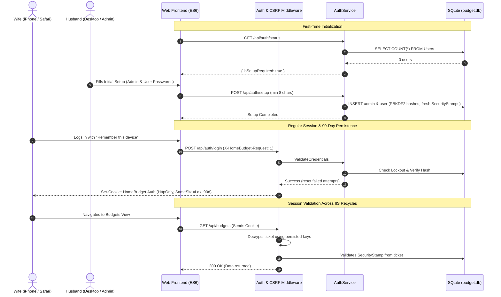

# Implementation Plan: Role-Based User Authentication & Security Hardening (v2.9)

**Document Version:** 1.0 (Aligns with `design_doc.md` v2.9)  
**Target Architecture:** ASP.NET Core (.NET 10 Minimal APIs) + SQLite (WAL Mode) + Windows 11 IIS + Vanilla ES6  
**Primary Roles:** `Admin` (Husband) and `User` (Wife)  

---

## 1. Executive Summary & Goals

This plan outlines the complete engineering tasks to transition HomeBudget from an open household trust model to an authenticated **Role-Based Access Control (RBAC)** system. 

### Key Deliverables:
1. **Dual-Persona RBAC:**
   - **`admin` (Husband):** Full control over CSV ingestion, raw transaction edits/splits/deletions, account management, database lifecycle (Reset All, Clear History), backup restore, and user password administration.
   - **`user` (Wife):** Access to Budgets, Cashflow & Sankey visualizations, category CRUD, expense recategorization with forward rule creation (`applyMovingForward`) and historical propagation (`applyToPast`), and read-only Transaction Inspector access.
2. **Friction-Free Mobile Sessions (iOS Safari):**
   - 90-day persistent cookie sessions (`IsPersistent = true`) with sliding expiration.
   - Disk-persisted Data Protection keys (`C:\ProgramData\HomeBudget\keys`) so IIS worker process recycles never terminate active sessions.
3. **Password Security & Lifecycle:**
   - First-run onboarding wizard (`POST /api/auth/setup`).
   - PBKDF2 password hashing (HMAC-SHA512, 100,000 iterations, 128-bit salt) using ASP.NET Core `PasswordHasher<TUser>`.
   - Minimum 8-character password policy.
   - 15-minute brute-force lockout after 5 consecutive failed attempts per account.
   - Immediate session invalidation via `SecurityStamp` when passwords change.
   - IIS failsafe emergency reset via `appsettings.json` (`HomeBudget:AdminPasswordResetOverride`).
4. **Data Integrity & Lifecycle Protection:**
   - User logins and credentials **strictly preserved** across database restores (`POST /api/backups/restore*`) and clean resets (`POST /api/admin/reset-all`).
5. **CSRF Protection:**
   - `SameSite=Lax` cookies + custom `X-HomeBudget-Request: 1` header verification on mutating calls.
6. **Optional LAN HTTPS Runbook:**
   - Ready-to-execute PowerShell / `mkcert` deployment runbook for IIS port `8443` and iOS Safari full certificate trust.

---

## 2. Architecture & Component Interaction



---

## 3. Detailed Implementation Phases

### Phase 1: Database Schema & Migration (`Users` Table)

#### 1.1 Schema Definition (`deploy/schema.sql`)
Add the `Users` table and username index:
```sql
CREATE TABLE IF NOT EXISTS Users (
    UserId               INTEGER PRIMARY KEY AUTOINCREMENT,
    Username             TEXT    NOT NULL UNIQUE COLLATE NOCASE, -- 'admin', 'user'
    PasswordHash         TEXT    NOT NULL,
    DisplayName          TEXT    NOT NULL,                       -- 'Husband', 'Wife'
    Role                 TEXT    NOT NULL CHECK (Role IN ('Admin', 'User')),
    SecurityStamp        TEXT    NOT NULL DEFAULT '',            -- UUID for session revocation
    FailedLoginAttempts  INTEGER NOT NULL DEFAULT 0,             -- Lockout tracker
    LockoutEndUtc        TEXT    NULL,                           -- ISO-8601 lockout expiration
    IsActive             INTEGER NOT NULL DEFAULT 1,
    LastLoginAt          TEXT    NULL,
    CreatedAt            TEXT    NOT NULL DEFAULT (datetime('now')),
    UpdatedAt            TEXT    NOT NULL DEFAULT (datetime('now'))
);

CREATE INDEX IF NOT EXISTS IX_Users_Username ON Users(Username);
```

#### 1.2 Idempotent Schema Migrations (`src/HomeBudget.Web/Data/DatabaseInitializer.cs`)
In `ApplyIdempotentSchemaMigrationsAsync`:
1. Check if `Users` table exists in `sqlite_master`. If missing, execute `CREATE TABLE IF NOT EXISTS Users`.
2. Inspect `pragma_table_info('Users')`:
   - If missing `SecurityStamp`, add column `SecurityStamp TEXT NOT NULL DEFAULT ''`.
   - If missing `FailedLoginAttempts`, add column `FailedLoginAttempts INTEGER NOT NULL DEFAULT 0`.
   - If missing `LockoutEndUtc`, add column `LockoutEndUtc TEXT NULL`.

#### 1.3 Preserving Users Across Clean Resets (`DatabaseInitializer.RecreateCleanSchemaAsync`)
Modify table teardown logic:
1. In `RecreateCleanSchemaAsync`, **exclude `Users` from the dropped tables**, or cache existing `Users` rows in-memory before dropping and re-insert them immediately after recreating schema.
2. Ensure that `ResetAllDatabaseAsync` never wipes user credentials.

#### 1.4 Preserving Users Across Backup Restores (`src/HomeBudget.Web/Services/BackupService.cs`)
In `RestoreSnapshotAsync` and `RestoreUploadedSnapshotAsync`:
1. Query current live users: `SELECT * FROM Users;` into a local list.
2. Perform the atomic SQLite copy/restore.
3. Run `ApplyIdempotentSchemaMigrationsAsync(targetConn)` on the restored database.
4. If the cached users list is non-empty, re-insert/upsert the active users into the restored database under a transaction, ensuring active credentials survive restores of older v1–v2.8 snapshots.

---

### Phase 2: Data Protection, Cookie Authentication & Middleware

#### 2.1 Persisted Data Protection Keys (`src/HomeBudget.Web/Program.cs`)
Configure ASP.NET Core Data Protection to store cryptographic keys in `<DatabaseDirectory>\keys\`:
```csharp
string programDataDir = Path.GetDirectoryName(dbPath) ?? @"C:\ProgramData\HomeBudget";
string keysDir = Path.Combine(programDataDir, "keys");
Directory.CreateDirectory(keysDir);

builder.Services.AddDataProtection()
    .PersistKeysToFileSystem(new DirectoryInfo(keysDir))
    .SetApplicationName("HomeBudget");
```

#### 2.2 Cookie Authentication Setup (`src/HomeBudget.Web/Program.cs`)
```csharp
builder.Services.AddAuthentication(CookieAuthenticationDefaults.AuthenticationScheme)
    .AddCookie(options =>
    {
        options.Cookie.Name = "HomeBudget.Auth";
        options.Cookie.HttpOnly = true;
        options.Cookie.SameSite = SameSiteMode.Lax;
        options.Cookie.SecurePolicy = CookieSecurePolicy.SameAsRequest;
        options.ExpireTimeSpan = TimeSpan.FromDays(90);
        options.SlidingExpiration = true;
        options.Events = new CookieAuthenticationEvents
        {
            OnRedirectToLogin = ctx =>
            {
                ctx.Response.StatusCode = StatusCodes.Status401Unauthorized;
                return Task.CompletedTask;
            },
            OnRedirectToAccessDenied = ctx =>
            {
                ctx.Response.StatusCode = StatusCodes.Status403Forbidden;
                return Task.CompletedTask;
            },
            OnValidatePrincipal = async ctx =>
            {
                var authService = ctx.HttpContext.RequestServices.GetRequiredService<AuthService>();
                bool isValid = await authService.ValidatePrincipalSecurityStampAsync(ctx.Principal);
                if (!isValid)
                {
                    ctx.RejectPrincipal();
                    await ctx.HttpContext.SignOutAsync(CookieAuthenticationDefaults.AuthenticationScheme);
                }
            }
        };
    });

builder.Services.AddAuthorization(options =>
{
    options.AddPolicy("AdminOnly", policy => policy.RequireRole("Admin"));
    options.AddPolicy("Authenticated", policy => policy.RequireAuthenticatedUser());
});
```

#### 2.3 CSRF Header Validation Middleware (`src/HomeBudget.Web/Program.cs`)
Add lightweight middleware before routing:
- For HTTP methods `POST`, `PUT`, `DELETE`:
  - Allow `/api/auth/login` and `/api/auth/setup` without custom header (or require header consistently via frontend).
  - For all other mutating routes, check if request contains header `X-HomeBudget-Request: 1`. If missing, return `400 Bad Request ("Missing required CSRF header")`.

---

### Phase 3: Backend Authentication Models & `AuthService`

#### 3.1 Models & DTOs (`src/HomeBudget.Web/Models/Entities.cs` & `Dtos.cs`)
```csharp
public sealed class User
{
    public int UserId { get; set; }
    public string Username { get; set; } = "";
    public string PasswordHash { get; set; } = "";
    public string DisplayName { get; set; } = "";
    public string Role { get; set; } = "User"; // "Admin" or "User"
    public string SecurityStamp { get; set; } = "";
    public int FailedLoginAttempts { get; set; }
    public string? LockoutEndUtc { get; set; }
    public bool IsActive { get; set; } = true;
    public string? LastLoginAt { get; set; }
    public string CreatedAt { get; set; } = "";
    public string UpdatedAt { get; set; } = "";
}

public record AuthStatusDto(bool IsSetupRequired, bool IsAuthenticated, string? Username, string? DisplayName, string? Role);
public record SetupRequest(string AdminDisplayName, string AdminPassword, string UserDisplayName, string UserPassword);
public record LoginRequest(string Username, string Password, bool RememberMe);
public record ChangePasswordRequest(string CurrentPassword, string NewPassword);
public record ResetUserPasswordRequest(string NewPassword);
public record UserSummaryDto(int UserId, string Username, string DisplayName, string Role, bool IsActive, string? LastLoginAt, bool IsLockedOut);
```

#### 3.2 Service Implementation (`src/HomeBudget.Web/Services/AuthService.cs`)
Implement the following methods:
1. `Task<bool> IsSetupRequiredAsync()`: `SELECT COUNT(*) == 0 FROM Users;`
2. `Task CompleteInitialSetupAsync(SetupRequest req)`:
   - Validate passwords $\ge 8$ chars.
   - Hash passwords with `PasswordHasher<User>`.
   - Insert `admin` and `user` records with fresh `SecurityStamp = Guid.NewGuid().ToString("N")`.
3. `Task<(bool Success, string? Error, User? User)> AuthenticateAsync(string username, string password)`:
   - Look up user by username (`COLLATE NOCASE`).
   - Check `LockoutEndUtc`: If $> \text{now}$, return error: `"Account is locked due to multiple failed logins. Try again in {minutes} minute(s)."`.
   - Verify password:
     - If failure: increment `FailedLoginAttempts`. If attempts $\ge 5$, set `LockoutEndUtc = DateTime.UtcNow.AddMinutes(15)`. Return `"Invalid username or password."`.
     - If success: reset `FailedLoginAttempts = 0`, `LockoutEndUtc = null`, update `LastLoginAt = DateTime.UtcNow.ToString("o")`. Return User.
4. `Task<bool> ValidatePrincipalSecurityStampAsync(ClaimsPrincipal? principal)`:
   - Extract `UserId` and `SecurityStamp` claim.
   - Query DB for user. If user is null, inactive, or `dbUser.SecurityStamp != claimStamp`, return `false`.
5. `Task<(bool Success, string? Error)> ChangePasswordAsync(int userId, string currentPassword, string newPassword)`:
   - Validate new password length $\ge 8$.
   - Verify current password.
   - Hash new password, generate new `SecurityStamp`, update DB.
6. `Task<(bool Success, string? Error)> ResetUserPasswordAsync(int targetUserId, string newPassword)`:
   - Validate new password length $\ge 8$.
   - Hash new password, generate new `SecurityStamp`, reset lockout attempts, update DB.
7. `Task CheckAdminPasswordOverrideAsync(IConfiguration config)`:
   - On startup, read `HomeBudget:AdminPasswordResetOverride`. If non-empty:
     - Update `admin` password, reset `SecurityStamp`, clear lockout, and log warning.

---

### Phase 4: API Endpoint Gating (`src/HomeBudget.Web/Program.cs`)

Map and protect Minimal API routes:

| Route | Policy / Authorization | Handler Logic |
| :--- | :--- | :--- |
| `GET /api/auth/status` | AllowAnonymous | Returns `{ isSetupRequired, isAuthenticated, user }` |
| `POST /api/auth/setup` | AllowAnonymous | Calls `AuthService.CompleteInitialSetupAsync`. Aborts if setup already done. |
| `POST /api/auth/login` | AllowAnonymous | Validates credentials, issues cookie via `HttpContext.SignInAsync`. |
| `POST /api/auth/logout` | RequireAuthorization | Calls `HttpContext.SignOutAsync`. |
| `GET /api/auth/me` | RequireAuthorization | Returns current user claims. |
| `PUT /api/auth/change-password` | RequireAuthorization | Calls `AuthService.ChangePasswordAsync`. |
| `GET /api/users` | RequireAuthorization("AdminOnly") | Lists users with lockout status. |
| `PUT /api/users/{id}/reset-password` | RequireAuthorization("AdminOnly") | Resets target user's password. |
| `POST /api/uploads/stage` | RequireAuthorization("AdminOnly") | CSV upload staging |
| `POST /api/uploads/commit` | RequireAuthorization("AdminOnly") | CSV upload commit |
| `PUT /api/transactions/{id}` | RequireAuthorization("AdminOnly") | Edit raw transaction |
| `POST /api/transactions/{id}/split` | RequireAuthorization("AdminOnly") | Split transaction |
| `DELETE /api/transactions/{id}` | RequireAuthorization("AdminOnly") | Delete transaction |
| `POST /api/transactions/bulk-delete` | RequireAuthorization("AdminOnly") | Bulk delete transactions |
| `POST /api/transactions/clear-history`| RequireAuthorization("AdminOnly")| Clear transaction history |
| `POST /api/admin/reset-all` | RequireAuthorization("AdminOnly") | Reset all database information |
| `POST /api/accounts` / `PUT /api/accounts/{id}` | RequireAuthorization("AdminOnly") | Add / Rename account |
| `POST /api/rules/back-propagate` | RequireAuthorization("AdminOnly") | Bulk rule back-propagation |
| `/api/backups/*` | RequireAuthorization("AdminOnly") | All backup management & restore routes |
| `POST /api/transactions/{id}/categorize` | RequireAuthorization | Shared: allows Wife to recategorize with forward & past flags |
| `GET /api/categories`, `POST/PUT/DELETE /api/categories/*` | RequireAuthorization | Shared: allows Wife full category management |
| `POST /api/rules`, `PUT /api/rules/{id}`, `DELETE /api/rules/{id}` | RequireAuthorization | Shared: allows Wife to add/delete rules |
| `GET /api/cashflow`, `GET /api/budgets/*`, `GET /api/transactions` | RequireAuthorization | Shared data views |

---

### Phase 5: Frontend Views, Navigation & Security Adaptations

#### 5.1 Global Application State (`src/HomeBudget.Web/wwwroot/js/app.js`)
1. Extend `state` with `currentUser: null`.
2. Update `apiFetch(url, options)`:
   - Automatically attach header `'X-HomeBudget-Request': '1'` on all requests.
   - Include `credentials: 'same-origin'`.
   - If response status is `401 Unauthorized`, clear `state.currentUser` and trigger `renderLoginView(container)`.
3. In `initApp()`:
   - Call `GET /api/auth/status`.
   - If `isSetupRequired == true`, open `renderSetupModal()`.
   - If `!isAuthenticated`, open `renderLoginView()`.
   - If authenticated, set `state.currentUser`, render header user pill, and proceed to requested view.

#### 5.2 Header Navigation & Role Visibility (`src/HomeBudget.Web/wwwroot/js/app.js`)
Dynamically render navigation items based on `state.currentUser.role`:
- **`Admin` navigation:**
  `[Monthly Budgets] [Cashflow & Sankey] [Upload CSVs] [Transaction Inspector] [Categories & Admin]`
- **`User` (Wife) navigation:**
  `[Monthly Budgets] [Cashflow & Sankey] [Transaction Inspector] [Categories & Rules]`
  *(The "Upload CSVs" tab is hidden entirely).*
- **User Profile Menu:**
  - Displays user avatar and name: `Husband (Admin)` or `Wife`.
  - Dropdown items:
    - **Change Password...** (`openChangePasswordModal()`)
    - **Log Out** (`POST /api/auth/logout`)

#### 5.3 Login & Setup Views
1. **Login View (`src/HomeBudget.Web/wwwroot/js/views/loginView.js`):**
   - Clean, mobile-optimized card with inputs: `Username` (`admin` or `user`), `Password`, and a pre-checked `[x] Remember this device (90 days)` checkbox.
   - Handles lockout messaging: *"Account temporarily locked. Please try again in X minutes."*
2. **Setup Modal (`openInitialSetupModal`):**
   - Non-dismissible modal asking to configure passwords for `admin` and `user` (with min 8-character validation).

#### 5.4 Transaction Inspector Role Adaptation (`src/HomeBudget.Web/wwwroot/js/views/inspectorView.js`)
- If `state.currentUser.role === 'User'`:
  - Render search, date presets, category filters, account filters, and the transactions data table in read-only mode.
  - Hide header buttons: `🗑 Clear Transaction History...`, `⚠️ Reset All Information...`.
  - In each transaction table row, hide: `Edit`, `Split`, `Delete` buttons. (Retain `Recategorize` button so she can reassign categories).

#### 5.5 Categories & Rules View Role Adaptation (`src/HomeBudget.Web/wwwroot/js/views/topologyView.js`)
- If `state.currentUser.role === 'User'`:
  - Show **Section 1: Spending Category Topology** (Full Add, Edit, Delete, Reorder).
  - Show **Section 2: Auto-Categorization Rules** (View rules, Add rule, Delete rule; hide `⚡ Preview & Back-Propagate Rules` button).
  - Completely hide **Section 3: Source Accounts & Cards**, **Section 4: Household Income**, and **Section 5: Backups & Admin**.
- If `state.currentUser.role === 'Admin'`:
  - Show all 5 sections.
  - In Section 5, add a **User Accounts & Security** sub-panel listing `admin` and `user`, displaying last login timestamp, lockout status, and a **Reset Password** button for the `user` account.

---

### Phase 6: Automated Testing & Verification

1. **Unit Tests (`tests/HomeBudget.Tests/AuthServiceTests.cs`):**
   - Verify PBKDF2 hashing & verification.
   - Verify lockout triggers after 5 failed attempts within 15 minutes.
   - Verify successful login resets failed attempt counter.
   - Verify password change regenerates `SecurityStamp`.
   - Verify minimum 8-character password enforcement.
2. **Integration Tests (`tests/HomeBudget.Tests/DatabaseAndServicesIntegrationTests.cs`):**
   - Verify initial setup flow (`POST /api/auth/setup`).
   - Verify cookie issuance and authentication.
   - Verify Admin-only endpoint gating returns `403 Forbidden` for `User` role.
   - Verify `ResetAllDatabaseAsync` preserves `Users` table and credentials.
   - Verify `RestoreSnapshotAsync` preserves active `Users` across restore.
   - Verify emergency admin password reset override from configuration.
3. **Frontend Verification (`tests/frontend_verification.mjs`):**
   - Verify syntax of all updated ES6 modules (`node --check`).
   - Assert `X-HomeBudget-Request` header presence in `apiFetch`.
   - Assert role-based visibility rules for nav tabs, inspector buttons, and topology sections.

---

### Phase 7: Optional LAN HTTPS / TLS Deployment Runbook

For a green lock and warning-free experience on iPhone Safari over LAN:

#### Step 1: Install `mkcert` on Host PC
Open administrative PowerShell on the Windows 11 host PC:
```powershell
choco install mkcert
# or download mkcert.exe from GitHub releases
mkcert -install
```

#### Step 2: Generate Certificate for PC Hostname & LAN IP
```powershell
$lanIp = (Get-NetIPAddress -AddressFamily IPv4 -InterfaceAlias "Wi-Fi*","Ethernet*").IPAddress | Select-Object -First 1
mkcert -pkcs12 -p12-file homebudget.pfx homebudget.local $lanIp localhost 127.0.0.1
```

#### Step 3: Bind Port 8443 in IIS Manager
1. Open **IIS Manager** (`inetmgr`).
2. Navigate to **Server Certificates** -> **Import** -> Select `homebudget.pfx`.
3. Right-click the **HomeBudget** website -> **Edit Bindings...** -> **Add...**:
   - Type: `https`
   - Port: `8443`
   - SSL Certificate: Select the imported `homebudget.local` certificate.
4. Open port `8443` in Windows Defender Firewall for `LocalSubnet`:
   ```powershell
   New-NetFirewallRule -DisplayName "HomeBudget HTTPS LAN" -Direction Inbound -LocalPort 8443 -Protocol TCP -Action Allow -RemoteAddress LocalSubnet
   ```

#### Step 4: Install Root CA on Wife's iPhone (One-Time 60-Second Setup)
1. Find `rootCA.pem` path by running `mkcert -CAROOT`.
2. AirDrop or email `rootCA.pem` to the iPhone.
3. On the iPhone:
   - Tap **Profile Downloaded** in **Settings** -> Tap **Install**.
   - Go to **Settings** -> **General** -> **About** -> **Certificate Trust Settings**.
   - Under "Enable full trust for root certificates", toggle **ON** for the local CA.
4. Open Safari to `https://<PC-LAN-IP>:8443` -> Enjoy a native, permanent green lock with 90-day persistent mobile login!

---

## 4. File Modification Index

| File Path | Description of Changes |
| :--- | :--- |
| `deploy/schema.sql` | Add `Users` table and `IX_Users_Username` index |
| `src/HomeBudget.Web/Data/DatabaseInitializer.cs` | Add idempotent `Users` migration; preserve `Users` in `RecreateCleanSchemaAsync` |
| `src/HomeBudget.Web/Services/BackupService.cs` | Preserve active `Users` table across database snapshot restores |
| `src/HomeBudget.Web/Models/Entities.cs` | Add `User` entity class |
| `src/HomeBudget.Web/Models/Dtos.cs` | Add auth request/response DTOs (`LoginRequest`, `SetupRequest`, `ChangePasswordRequest`, etc.) |
| `src/HomeBudget.Web/Services/AuthService.cs` | Implement hashing, setup, credential checks, lockout, and password management |
| `src/HomeBudget.Web/Program.cs` | Configure Data Protection key persistence, Cookie Auth, CSRF check, and auth routes |
| `src/HomeBudget.Web/wwwroot/js/app.js` | Add `currentUser` state, CSRF header in `apiFetch`, role-based navigation, user header menu |
| `src/HomeBudget.Web/wwwroot/js/views/loginView.js` | Create mobile-responsive login interface with 90-day remember-me |
| `src/HomeBudget.Web/wwwroot/js/views/inspectorView.js` | Enforce read-only UI controls when `role === 'User'` |
| `src/HomeBudget.Web/wwwroot/js/views/topologyView.js` | Render Sections 1 & 2 only for Wife; add User Management in Section 5 for Admin |
| `tests/HomeBudget.Tests/AuthServiceTests.cs` | Add unit tests for hashing, lockout, and password change |
| `tests/HomeBudget.Tests/DatabaseAndServicesIntegrationTests.cs` | Add integration tests for auth routes, role gating, and reset/restore preservation |
| `tests/frontend_verification.mjs` | Add syntax and role assertion tests for new frontend modules |
| `docs/https_setup_runbook.md` | Add IIS port 8443 and mkcert setup runbook |
